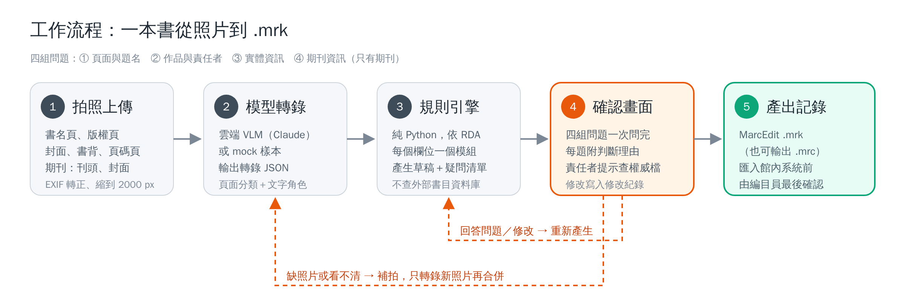
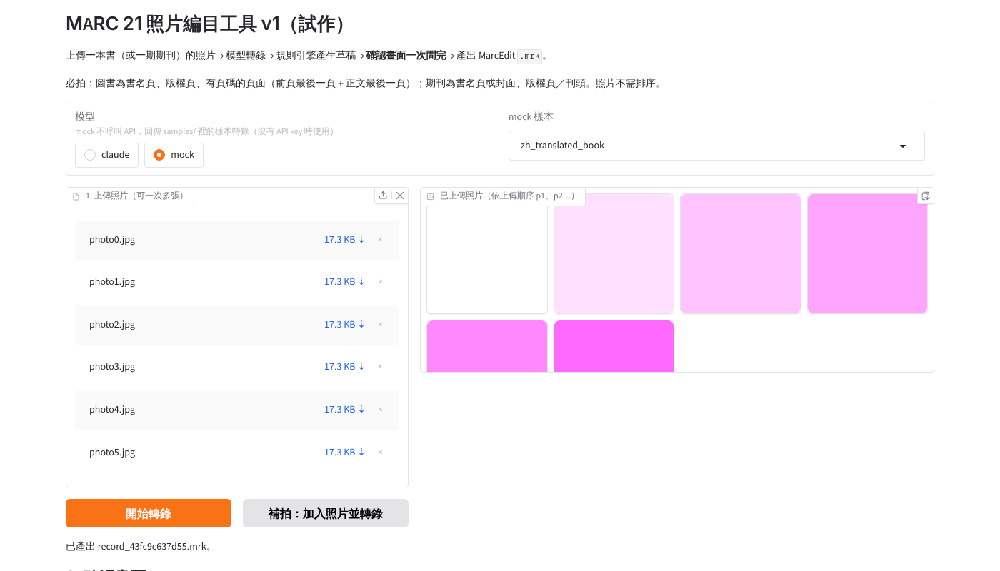
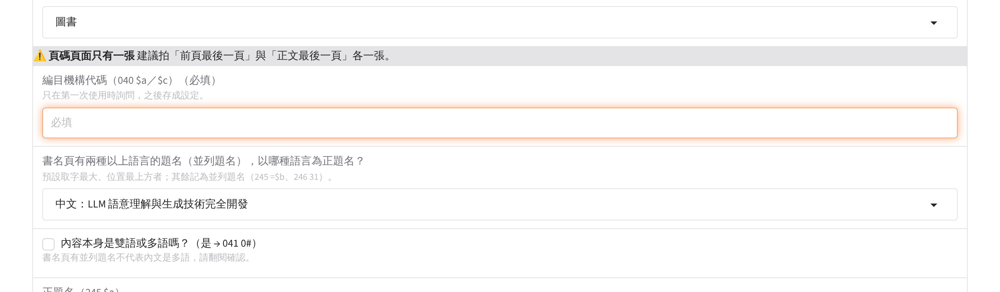
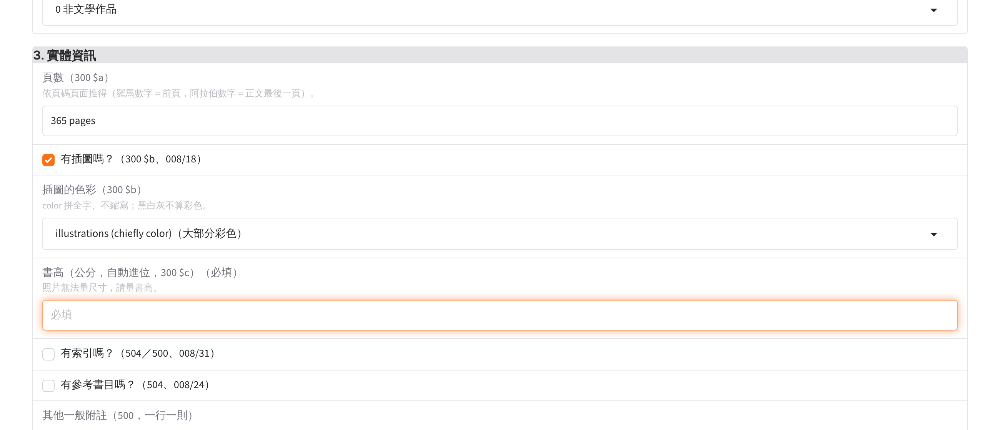
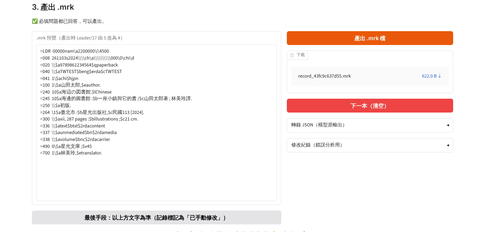
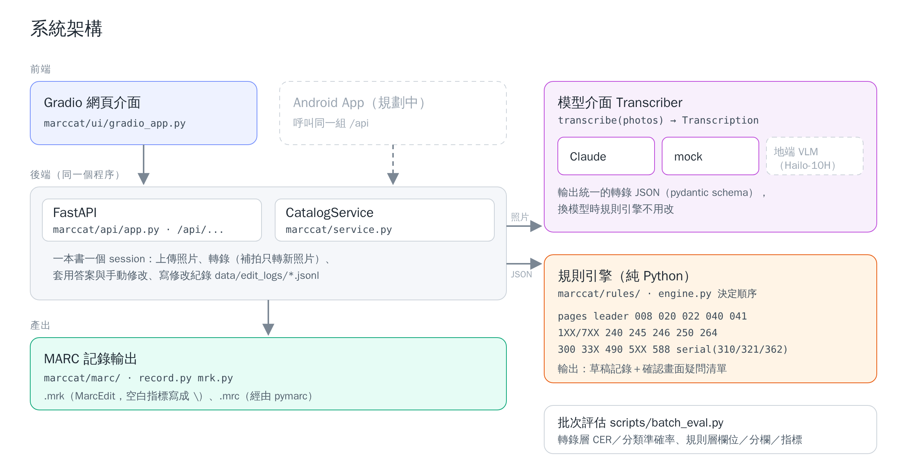

<div align="center">

# photo2marc

**拍幾張照片，就能產生一筆 RDA／MARC 21 書目記錄**

*From a few photos of a book to a cataloger-ready MARC 21 record.*

`VLM` · `Rule engine` · `Human-in-the-loop` · `Python` · `FastAPI` · `Gradio`

[English summary](#english-summary)

</div>

> 本 repository 是專案介紹，不包含程式碼。目前是可運作的試作版（v1.2），如需展示歡迎與我聯絡。

## 一句話說明

圖書館遇到書目資料庫查不到的書，編目員只能一頁一頁翻書、照 RDA 規則手打 MARC 記錄。photo2marc 讓編目員只要拍下書名頁、版權頁等幾張照片，系統就會讀出書上的文字、套用編目規則、列出需要人判斷的問題，最後產出可以直接匯入館藏系統的 MarcEdit `.mrk` 檔。

## 要解決的問題

**Original cataloging（原始編目）** 是圖書館最花人力的工作之一，難處在於：

- **規則多又細**：RDA 與 MARC 21 對題名、責任者、出版項、頁數都有固定寫法，一筆記錄要寫十幾個欄位。
- **中文書特別麻煩**：民國紀年要補西元、版權頁和書名頁資訊不一致、中英並列題名、翻譯書要記原書名、異體字（例如「碁峰」與「碁峯」）。
- **直接丟給 AI 不夠可靠**：大型語言模型能讀照片，但會自信地猜錯，編目員也很難看出錯在哪裡。

## 解法與設計重點



**1. 「讀」和「判斷」分開**
**VLM（Vision-Language Model，視覺語言模型）** 只負責轉錄：這張照片是哪一頁、上面每段文字是什麼、扮演什麼角色（題名、著者、出版者…）。MARC 欄位則由純 Python 的規則引擎依 RDA 產生，每個欄位一個模組。這樣模型讀錯字和規則判斷錯可以分開找出來，規則也能逐條寫測試。

**2. 不確定就問，不要猜**
規則沒把握的地方，例如並列題名以哪種語言為主、誰是主要款目、缺了哪一頁照片，都整理成問題，並附上判斷理由。問題分成四組，在同一個確認畫面一次問完，編目員不必來回操作。

**3. 每次修改都留下紀錄**
編目員改了什麼，都記錄成「模型原本的輸出」和「使用者改成什麼」，並歸類為轉錄錯誤、規則錯誤或本來就需要人輸入。這些紀錄是之後改善模型和規則的依據。

**4. 模型可以替換**
所有模型都輸出同一份轉錄 JSON 格式，換模型時規則引擎完全不用改。目前用雲端模型，最終目標是換成地端 VLM，讓整個流程能離線在 Android 裝置上執行。

**5. 用資料衡量，而不是憑感覺**
建立批次評估工具，分兩層計算指標：轉錄層看字元錯誤率與頁面分類準確率，規則層看欄位、分欄、指標的正確率。

## 畫面

| 上傳照片 | 確認畫面 |
| --- | --- |
|  |  |

| 必填欄位提示 | 插圖色彩選項 |
| --- | --- |
|  |  |



*畫面使用測試樣本，照片為測試用色塊。*

產出範例：

```
=LDR  00000nam\a2200000\i\4500
=008  261103s2021\\\\nyu\\\\\\b\\\\001\0\eng\d
=020  \\$a9781623456788$qpaperback
=040  \\$aTEST$beng$erda$cTEST
=100  1\$aDoe, Jane,$eauthor.
=245  14$aThe quiet archive :$ba history of small libraries /$cJane Doe and John Smith.
=250  \\$aSecond edition.
=264  \1$aNew York :$bRiverbend Press,$c[2021].
=264  \4$c©2021
=300  \\$avi, 312 pages ;$c24 cm
=336  \\$atext$btxt$2rdacontent
=337  \\$aunmediated$bn$2rdamedia
=338  \\$avolume$bnc$2rdacarrier
=504  \\$aIncludes bibliographical references and index.
=700  1\$aSmith, John,$eauthor.
```

## 系統架構



- 網頁介面與未來的 Android App 呼叫同一組 API。
- 規則引擎涵蓋 Leader、008、020、022、040、041、1XX／7XX、240、245、246、250、264、300、33X、490、5XX，以及期刊的 310、321、362、588。
- 不查詢任何外部書目資料庫或權威檔，責任者款目會提示編目員對照館內權威檔。

## 開發歷程

這個專案以「實際拿書測試 → 回饋 → 修改」的方式迭代：

| 版本 | 內容 |
| --- | --- |
| v1 | 圖書與期刊的描述編目、雲端 VLM 轉錄、確認畫面、`.mrk` 輸出、批次評估 |
| v1.1 | 實測回饋第一輪：插圖色彩選項、並列題名與翻譯書原書名的判斷、必填欄位提示、責任者去重、異體字提醒 |
| v1.2 | 實測回饋第二輪：並列題名偵測改成不依賴模型的語言標記，246 補上並列副題名 |

## 下一步

- [ ] **v2**：分類號（050／082）、主題詞、叢書檢索款目
- [ ] 用同一組書比較多家雲端 VLM 的轉錄表現
- [ ] 改用地端 VLM（Hailo-10H），搭配 Android App 離線使用

## 我的角色

<!-- 請依實際情況修改這一段 -->
- 從編目實務出發定義問題，撰寫設計文件與 MARC 欄位規則
- 設計「讀與判斷分離」、「不確定就問」的人機協作流程
- 拿實體書實測，整理回饋並主導每一版的修改方向
- 程式實作與 AI 程式助理協作完成

## 使用技術

Python · FastAPI · Gradio · pydantic · pymarc · Claude（VLM 轉錄） · pytest

---

## English summary

**photo2marc** turns a few photos of a book into a cataloger-ready MARC 21 record. It targets *original cataloging*, the labor-intensive work a librarian does when no existing record can be found.

**Key design decisions**

- **Separate reading from judging.** A vision-language model only transcribes what is printed on each page and labels its role. A pure-Python rule engine then applies RDA / MARC 21 conventions field by field, so transcription errors and rule errors can be told apart and tested independently.
- **Ask instead of guess.** Anything the rules are unsure about becomes a question with its reasoning, grouped on a single confirmation screen.
- **Log every correction** as model output vs. user value, classified as a transcription, rule or input issue, to drive the next round of improvements.
- **Swappable models.** All models emit the same transcription JSON, paving the way from a cloud model to an on-device VLM on Android.
- **Measure it.** A batch evaluation tool reports character error rate and page-classification accuracy for transcription, and field / subfield / indicator accuracy for the rules.

It handles Chinese-language specifics such as ROC calendar dates, parallel titles, translated works and variant characters. Status: working prototype (v1.2), iterated through hands-on testing with real books. This repository contains the project overview only; source code is not public.
